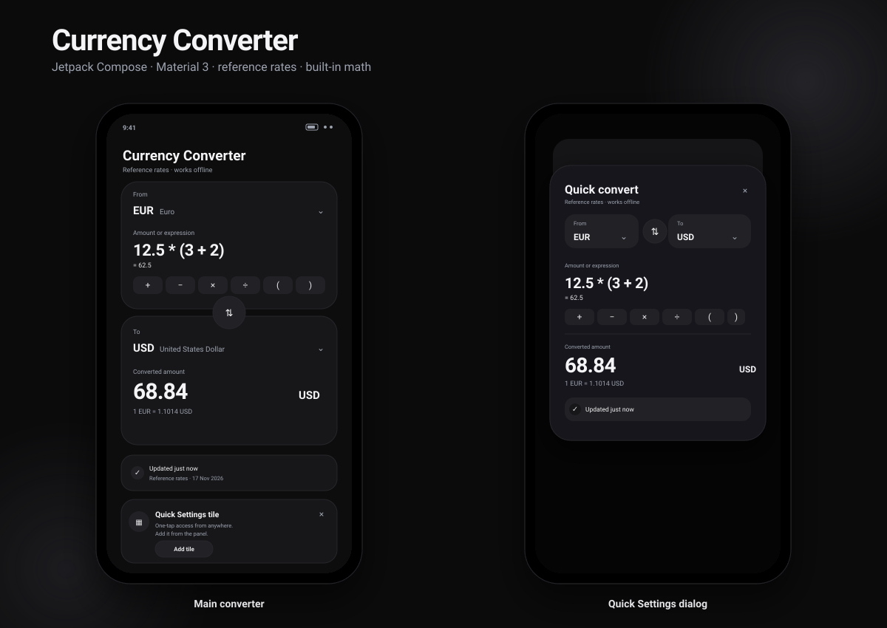
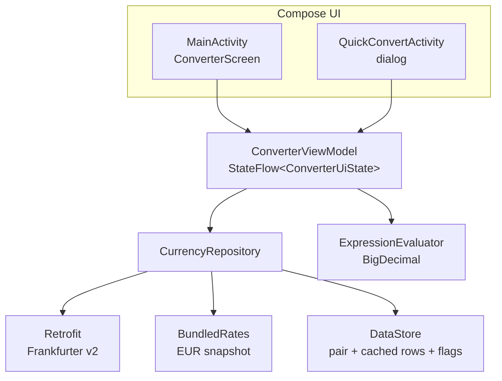

# Currency Converter

A complete, offline-friendly Android currency converter built with **Kotlin**, **Jetpack Compose** and **Material 3** — including a built-in arithmetic evaluator and an Android Quick Settings tile.


---

## UI overview



| Screen | What it does |
| --- | --- |
| **Converter** | Source/target currency pickers, live expression evaluation, a two-decimal converted result, unit rate, tappable sync pill and a dismissible Quick Settings promo. |
| **Quick convert** | A compact dialog launched from the Quick Settings tile, with the same pair, input and cached rates as the main app. |

> The image above is a vector UI mockup that ships with the repository. Replace it with real device screenshots after your first run (e.g. `docs/main-screen.png`).

## Features

- **Dark-first neutral design**: near-black canvas, charcoal cards with a 1 dp hairline border, graphite pills and silver accents. No green/teal tinting and no dynamic wallpaper colours by default.
- **Dual-currency converter** with a searchable currency picker (31 fiat currencies, including New Taiwan Dollar) and one-tap swap.
- **Live arithmetic input**: `+`, `-`, `*`, `/`, decimals, unary signs and arbitrarily nested parentheses.
- **Instant results** while typing — parsing and conversion happen in memory with `BigDecimal`, no network round-trip.
- **Two-decimal results**: the primary converted amount is always locale-formatted with exactly two decimals (`13,38`), while the unit rate keeps up to six (`1 DKK = 0,133781 EUR`).
- **Offline-first rates**: the last successful response is cached in DataStore, and a bundled EUR snapshot is used before the first refresh — so a brand-new install in airplane mode still converts.
- **Remembers your currency pair** across launches.
- **Quick Settings tile** with an Android 14-compatible `PendingIntent` launch path, an in-app "Add tile" prompt on Android 13+, and automatic dismissal of the promo card once the tile is added.
- **No API key**, no analytics, no account. The only permission is `INTERNET`.

---

## Quick start

### Requirements

- Android Studio **Ladybug (2024.2.1)** or newer
- Android SDK **35** (Android Studio can install it)
- JDK **17** (the one bundled with Android Studio is fine)
- A device or emulator running **Android 8.0 (API 26)** or newer

### Android Studio

1. Clone/download this repository.
2. Open the **root folder** in Android Studio and let Gradle sync.
3. Select the `app` run configuration and press **Run**.
4. On first launch, rates are fetched from `https://api.frankfurter.dev/v2/rates?base=EUR`. No key or configuration is needed.
5. If your network is unavailable, the app still opens and converts using the bundled snapshot; real cached rates appear after the first successful refresh.

### Command line

```bash
# macOS / Linux
./gradlew assembleDebug
./gradlew test
./gradlew installDebug

# Windows (PowerShell / cmd)
gradlew.bat assembleDebug
gradlew.bat test
gradlew.bat installDebug
```

The debug APK is written to `app/build/outputs/apk/debug/app-debug.apk`.

`local.properties` is generated by Android Studio and is intentionally git-ignored. For a pure CLI build, create it yourself:

```properties
sdk.dir=/path/to/Android/Sdk
```

---

## How it works

### Architecture



The project is deliberately a **single module** with a minimal MVVM stack:

- **`ConverterViewModel`** owns a single `StateFlow<ConverterUiState>`. Derived fields (`expression`, `crossRate`, `convertedAmount`) are recalculated whenever input, currency pair or rates change, so both screens behave identically.
- **`CurrencyRepository`** is the only thing that knows about network + cache. It returns `Result<RateTable>` instead of throwing, which lets the UI keep cached rates on failure.
- **`BundledRates`** is a plain, EUR-based snapshot compiled into the app, used whenever no cache exists. It is flagged `isBundled = true` so the status pill can label it honestly as an offline estimate.
- **Compose screens** are stateless wherever possible (`ConverterScreen`, `QuickConvertScreen`) and receive state + callbacks. Previews need no ViewModel or network.
- **`AppContainer`** wires Moshi, OkHttp, Retrofit, DataStore and the repository once per process. No DI framework.

#### Startup sequence

1. Compose renders defaults immediately (`100` / `EUR → USD`).
2. `ConverterViewModel` observes the saved pair, the Quick Settings dismissal flag and restores the cached rate table from DataStore.
3. With no cache, `BundledRates.table` is used so the screen is never empty.
4. Rates are refreshed in the background.
5. On success the filtered table is cached and the UI updates. On failure the last good (or bundled) table stays visible and the status pill explains the state.

### Layout

The main screen is a single vertical scroll column:

1. **App bar** — title plus `Reference rates · works offline`, no refresh action.
2. **From / To cards** — 10 dp apart, with the circular `⇅` button straddling the shared seam. Its offset is measured from the source card's height, so it stays centred on the seam at any font scale.
3. **Currency selectors** — a lightweight header row (`From` / code / name / chevron) instead of a box inside the box.
4. **Sync status pill** — the whole pill is the refresh button; a `CircularProgressIndicator` replaces the cloud icon while a request is in flight.
5. **Quick Settings card** — has a close button; the dismissal is persisted, and the tile service sets the same flag when the tile is added.

Cards use `surfaceContainerLow` (`#17171A`) with a `1 dp` `outline` border (`#26262B`); pills and operator buttons use `surfaceContainerHighest` (`#222226`).

### Offline caching & rate maths

Frankfurter v2 returns a **flat array of quote rows**:

```json
[
  { "date": "2026-11-17", "base": "EUR", "quote": "USD", "rate": 1.1014 },
  { "date": "2026-11-17", "base": "EUR", "quote": "TWD", "rate": 36.285 }
]
```

Only the fields the app needs are modelled (`date`, `base`, `quote`, `rate`). Two things happen before caching:

- `supportedEntries()` drops anything the picker cannot select — v2 also publishes crypto and metals rows, which are filtered out against `CurrencyCatalog.codes`.
- `toRateTable()` pins the base to `1.0`, keeps the newest `date` and discards non-finite, zero or negative rates so a bad payload can never divide by zero.

The filtered rows are cached as JSON in Preferences DataStore (`cached_rates_json` + `cached_rates_fetched_at`), so the cache stays tiny and fully decodable. Any pair is then derived locally:

```
rate(from → to) = rate(to) / rate(from)
converted = evaluatedExpression × rate(from → to)
```

That is why currency switching and editing are instant, and why no per-pair network request is required.

A refresh runs on every app start. If the API is unavailable, the last good table is used indefinitely, or `BundledRates` if there is no cache. The status pill always states which one is in play:

| State | Status pill | Second line |
| --- | --- | --- |
| First launch, no cache yet | `Built-in estimates · tap to refresh` | `Offline snapshot · 17 Nov 2026` |
| Cached table, refresh failed | `Offline · showing saved rates` | `Reference rates · <date>` |
| Fresh response | `Updated <relative time>` | `Reference rates · <date>` |

Rates are reference rates published once per working day, so there is no benefit to polling more aggressively.

### Arithmetic evaluator

[`ExpressionEvaluator.kt`](app/src/main/java/dev/currency/converter/domain/parser/ExpressionEvaluator.kt) is a self-contained recursive-descent parser (no third-party math library):

```
expression := term (('+' | '-') term)*
term       := factor (('*' | '/') factor)*
factor     := ('+' | '-') factor | '(' expression ')' | number
number     := digits ('.' digits*)? | '.' digits+
```

- `BigDecimal` + `MathContext(16, HALF_UP)` keeps money-scale calculations accurate.
- Unary signs, nested parentheses, whitespace and leading decimals (`.5`) are supported.
- Typographic `×`, `÷`, `−` are normalised to their ASCII equivalents.
- A comma is accepted as a decimal separator because many mobile numeric keyboards emit one. Thousands separators are **not** supported.
- Implicit multiplication is **not** supported; write `2 * (3 + 4)`.
- Failures are typed (`INCOMPLETE_EXPRESSION`, `DIVISION_BY_ZERO`, `UNBALANCED_PARENTHESES`, etc.) so the UI can show friendly, localisable copy instead of a generic error.
- Input is capped at 120 characters, numbers at 24 digits, and parenthesis depth at 32 to keep pasted input cheap.

Examples:

| Input | Evaluated |
| --- | --- |
| `12.5 * (3 + 2)` | `62.5` |
| `((2 + 3) * (4 - 1)) / 5` | `3` |
| `-2 * (3 + 4)` | `-14` |
| `10 / 4` | `2.5` |
| `1 / 0` | Error: “Can’t divide by zero.” |
| `(1 + 2` | Error: “Check the parentheses.” |

### Quick Settings tile

The tile is implemented in
[`ConverterTileService`](app/src/main/java/dev/currency/converter/tile/ConverterTileService.kt) and declared in the manifest with:

```xml
<service
    android:name=".tile.ConverterTileService"
    android:exported="true"
    android:icon="@drawable/ic_qs_convert"
    android:label="@string/quick_tile_label"
    android:permission="android.permission.BIND_QUICK_SETTINGS_TILE">
    <intent-filter>
        <action android:name="android.service.quicksettings.action.QS_TILE" />
    </intent-filter>
</service>
```

Flow:

1. The user adds the tile from the Quick Settings edit screen (or taps **Add tile** in the app on Android 13+).
2. `onTileAdded()` persists `quick_settings_card_dismissed = true`; the main screen observes the same DataStore key, so the promo card disappears by itself.
3. `onStartListening()` sets a neutral tile state, label and subtitle; the tile is an action, not a toggle.
4. `onClick()` opens `QuickConvertActivity` — a translucent, recents-free dialog activity.
5. On **Android 14+ (API 34)**, the launch uses the required
   `startActivityAndCollapse(PendingIntent)` overload with `FLAG_IMMUTABLE`.
   On Android 8–13, the deprecated `Intent` overload is used behind a version check.
6. Both activities use the same ViewModel type and the same DataStore file, so a pair changed in the dialog appears in the main screen immediately.
7. The dialog is translucent and excluded from recents, so dismissing it returns to the previous app.

**Android 13+ in-app prompt:** [`QuickSettingsTileHelper`](app/src/main/java/dev/currency/converter/tile/QuickSettingsTileHelper.kt) calls `StatusBarManager.requestAddTileService(...)` while the app is in the foreground. Older versions have no public API for this, so the card shows manual instructions instead.

---

## Project structure

```text
Converter/
├── app/
│   ├── build.gradle.kts
│   ├── proguard-rules.pro
│   └── src/
│       ├── main/
│       │   ├── AndroidManifest.xml
│       │   ├── java/dev/currency/converter/
│       │   │   ├── ConverterApplication.kt      # process-wide AppContainer
│       │   │   ├── MainActivity.kt
│       │   │   ├── QuickConvertActivity.kt      # tile destination
│       │   │   ├── data/
│       │   │   │   ├── CurrencyRepository.kt    # fetch + filter + cache + fallback
│       │   │   │   ├── prefs/UserPreferencesRepository.kt
│       │   │   │   └── remote/                  # Retrofit API + v2 row DTO/mapping
│       │   │   ├── di/AppContainer.kt
│       │   │   ├── domain/
│       │   │   │   ├── ConversionMath.kt
│       │   │   │   ├── CurrencyDefaults.kt      # ← defaults live here
│       │   │   │   ├── model/                   # catalog, RateTable, BundledRates
│       │   │   │   └── parser/ExpressionEvaluator.kt
│       │   │   ├── tile/                        # TileService + add-tile helper
│       │   │   ├── ui/
│       │   │   │   ├── components/              # input field, picker sheet
│       │   │   │   ├── converter/               # ViewModel, screens, dialog, status text
│       │   │   │   ├── format/AmountFormatter.kt
│       │   │   │   └── theme/                   # colors, type, MaterialTheme
│       │   │   └── util/ContextExtensions.kt
│       │   └── res/
│       │       ├── drawable/                    # app + tile vectors
│       │       ├── mipmap-anydpi-v26/           # adaptive icon
│       │       ├── values/                      # strings, colors, themes
│       │       └── values-night/
│       └── test/java/dev/currency/converter/    # parser, rate-math, DTO, snapshot tests
├── docs/ui-overview.svg
├── gradle/wrapper/
├── build.gradle.kts
├── settings.gradle.kts
├── gradle.properties
├── gradlew / gradlew.bat
├── .gitignore
├── LICENSE
└── README.md
```

---

## Customization guide

Everything you are likely to change has a single obvious home.

### Default currencies and starting amount

**File:** `app/src/main/java/dev/currency/converter/domain/CurrencyDefaults.kt`

```kotlin
object CurrencyDefaults {
    const val SOURCE_CURRENCY_CODE = "EUR"   // change to "GBP", "USD", ...
    const val TARGET_CURRENCY_CODE = "USD"
    const val INITIAL_INPUT = "100"
    const val API_BASE_URL = "https://api.frankfurter.dev/v2/"
    const val RATES_BASE_CODE = "EUR"        // base requested from the provider
}
```

Both codes must exist in `CurrencyCatalog`, otherwise startup throws while resolving the defaults (fail fast during development).

### Supported currencies

**File:** `app/src/main/java/dev/currency/converter/domain/model/Currency.kt`

Edit the `CurrencyCatalog.all` list. Each entry is `Currency(code, name, symbol)`; the symbol is shown as a hint in the picker (`TWD` → `NT$`). The picker, search and defaults all use this catalog, and it doubles as the allow-list that filters provider rows.

If you add a currency the API does not return, it remains selectable but the result shows “No rate available for this pair yet.”

To make the list fully remote, call the provider’s `/currencies` endpoint, cache it beside the rates, and replace `CurrencyCatalog.all` with the cached list — the UI only needs `List<Currency>`.

### Bundled offline snapshot

**File:** `app/src/main/java/dev/currency/converter/domain/model/BundledRates.kt`

`BundledRates.table` is a hand-copied EUR table (currently `2026-11-17`) used only when no cache exists. To refresh it, copy the provider’s EUR rates, keep `AS_OF_DATE` in sync, and make sure every code in `CurrencyCatalog` has an entry — `BundledRatesTest` fails if one is missing.

### Change the rate API

**Files:**

- `domain/CurrencyDefaults.kt` → `API_BASE_URL` (keep the trailing slash) and `RATES_BASE_CODE`
- `data/remote/FrankfurterApi.kt` → endpoint + query parameters
- `data/remote/RatesDto.kt` → JSON shape, `supportedEntries()` filtering and `toRateTable()` mapping
- `di/AppContainer.kt` → OkHttp timeouts / interceptors

The rest of the app consumes only `RateTable`, so a provider swap does not touch the UI. Requirements: the response must expose a base and a table of rates (or be mapped into one). The mapping should keep the base pinned to `1.0` and reject non-positive rates.

### Theme, colours and typography

| Goal | File |
| --- | --- |
| Palette, dark/light schemes, tonal surfaces | `ui/theme/Color.kt` |
| Font sizes, weights, line heights | `ui/theme/Type.kt` |
| Dark-first default, optional Android 12+ wallpaper colours | `ui/theme/Theme.kt` |
| Pre-Compose splash/window background | `res/values/colors.xml`, `res/values-night/colors.xml` |

The app forces `darkTheme = true` because the near-black palette is the product design; pass `darkTheme = false` in `ConverterTheme` for the neutral light scheme, or `dynamicColor = true` for wallpaper colours. Both activities also call `enableEdgeToEdge(SystemBarStyle.dark(...))` so status/navigation icons stay light even if the system is in light mode.

| Token | Hex | Used for |
| --- | --- | --- |
| Background | `#0B0B0C` | Screen and window background |
| Card | `#17171A` | From/To cards, status pill, promo card |
| Hairline | `#26262B` | `1 dp` borders and phone frames |
| Pill | `#222226` | Selectors, operator buttons, swap button |
| Primary text | `#F4F4F6` | Amounts, titles, currency codes |
| Muted text | `#9CA3AF` | Labels, names, rate subtitles |
| Accent | `#E4E4E7` | Icons and interactive accents |

### Number formatting

**File:** `ui/format/AmountFormatter.kt`

- `formatConverted` always shows **exactly two decimals** (`68.84`), locale-aware.
- `formatRate` shows **up to six decimals** with a minimum of two (`0.133697`).
- `formatExpression` keeps up to eight decimals for the `= …` feedback line.
- Dates from the API are formatted with the device locale.

All grouping is locale-aware, so `1234.5` renders as `1.234,5` in Italian and `1,234.5` in English.

### Refresh / caching policy

**Files:** `data/CurrencyRepository.kt`, `ui/converter/ConverterViewModel.kt`, `data/prefs/UserPreferencesRepository.kt`

Rates refresh on every launch and whenever the sync pill is tapped. Repeated taps are coalesced into one request because `refreshJob?.isActive` guards the ViewModel. If you want a time-to-live instead, compare `rateTable.fetchedAtMillis` with `System.currentTimeMillis()` in `ConverterViewModel.restoreSavedState()` and skip `refreshRates()` while fresh; `isBundled` must still trigger a refresh. The cache already stores the timestamp, so no schema change is required.

To clear saved state, clear app storage or uninstall the app. The keys are `source_currency`, `target_currency`, `cached_rates_json`, `cached_rates_fetched_at` and `quick_settings_card_dismissed`.

### Quick Settings / app icon

| Goal | File |
| --- | --- |
| Tile glyph (white, system-tinted) | `res/drawable/ic_qs_convert.xml` |
| Adaptive launcher foreground | `res/drawable/ic_launcher_foreground.xml` |
| Themed (monochrome) icon | `res/drawable/ic_launcher_monochrome.xml` |
| Adaptive icon background | `res/values/colors.xml` → `ic_launcher_background` |

After changing the tile icon, reinstall the app; Quick Settings caches tile icons aggressively.

### Copy, localisation and dialog behaviour

- All user-facing text: `res/values/strings.xml` (add `values-it/strings.xml`, etc. for translations).
- Quick dialog layout and auto-focus/keyboard: `ui/converter/QuickConvertDialog.kt`.
- Haptics on swap, sheet height, spacing: respective screen files.
- Tile and dialog dismissal: `QuickConvertActivity` + `QuickConvertScreen`.
- Promo-card dismissal copy and behaviour: `ui/converter/ConverterScreen.kt` + `ConverterTileService.onTileAdded()`.

---

## Testing

Unit tests cover the expression parser, cached-rate maths, the v2 DTO mapping and the bundled snapshot; they run on the JVM:

```bash
./gradlew test
# report: app/build/reports/tests/testDebugUnitTest/index.html
```

The suite currently has 20 tests, including:

- `RateEntryDto` parsing of `TWD` from the flat v2 row format.
- Filtering of crypto/metals rows against the currency catalog.
- Rejection of zero, negative and `NaN` rates.
- `BundledRates` coverage of every catalog currency and offline TWD cross-rates.

Manual checks worth doing before a release:

- Type `12.5 * (3 + 2)` and confirm `= 62.5`, a converted value with **exactly two decimals** and a six-decimal unit rate.
- Try `1 / 0`, `(1 + 2`, `abc`, `2(3)` and verify friendly errors, no crash.
- Select `TWD` in both directions (`EUR → TWD` and `TWD → EUR`) and confirm a rate appears, online and after a restart.
- Swap currencies and restart the app — the pair should persist.
- Load once, enable airplane mode, force-stop, relaunch — cached rates and conversions still work.
- Clear app storage, enable airplane mode, relaunch — the bundled snapshot is used and the pill reads `Built-in estimates`.
- Tap the sync pill and confirm the inline spinner replaces the icon, then the timestamp updates.
- Dismiss the Quick Settings card with `×`, restart, and confirm it stays hidden. Clear app data, add the tile, and confirm `onTileAdded()` hides it automatically.
- Check the layout in light system mode (the app stays dark) and with a large font scale — the swap button must remain centred on the card seam.
- Add the Quick Settings tile, open it from the shade, change currencies, dismiss with back/outside tap, then switch back to the still-open main app and confirm the new pair is already shown.
- Rotate while the picker/dialog is open and rotate with the keyboard visible.

### Offline verification

1. Launch online and wait for “Updated …”.
2. Turn on airplane mode.
3. Tap the sync pill — the app shows **Offline · showing saved rates** and keeps converting.
4. Force-stop and relaunch — the last table is restored from DataStore.

---

## API & attribution

Rates come from [Frankfurter](https://frankfurter.dev/), an open-source API. It is free, requires no API key, and its v2 endpoint publishes ECB reference rates plus additional quotes — including **New Taiwan Dollar (`TWD`)**, which v1 omitted.

- Base URL: `https://api.frankfurter.dev/v2/`
- Endpoint used: `GET /rates?base=EUR`
- Response shape: `[{ "date", "base", "quote", "rate" }]`
- Data updates: once per working day (ECB publication schedule)
- The response also contains crypto and precious-metal quotes; they are filtered out against the bundled currency catalog.
- Please keep caching enabled and avoid adding aggressive polling if you fork the app.

The exchange rates are indicative reference rates and are not suitable for trading, billing or other financial decisions.

## Notes & limitations

- Frankfurter publishes fiat currencies — no crypto or precious metals are offered in the picker, even though the v2 payload includes some.
- The bundled currency list is static; see the Customization Guide for a remote-list variant.
- The API returns one base table, so all conversions use the cached cross-rate method above. Spreads/fees are not modelled.
- The bundled snapshot is a point-in-time copy and can drift from live rates; the status pill labels it so it is never mistaken for a fresh quote.
- Quick Settings behavior can vary slightly by OEM; the manifest declaration and tile lifecycle are standard.
- Release builds are unminified by default. Add a signing config and opt into R8 (`isMinifyEnabled = true`) when publishing; Moshi/Retrofit keep rules are already included.

## License

MIT — see [LICENSE](LICENSE). Frankfurter and ECB rate data retain their respective terms.
